## Ejercicios VHDL

#### Objetivo

El alumno aprenderá el manejo de una tabla de verdad dentro de la instrucción process y verificará que la lista de sensibilidad está dada por las entradas en todo el sistema condicional.

### Parte 1. Control de pago de multas

#### Especificaciones

Sí la luz roja se prende el infractor paga la multa y si la luz verde se prende no la paga, las luces no se pueden prender simultáneamente.

Este sistema tiene por entrada la decisión de un jurado compuesto por tres personas $A_1 A_2 A_3$ Cuyas opiniones valen: $A_2=35\%$, $A_1=30\%$, $A_0=15\%$.

Un $1$ lógico a la entrada significa que el juez desea que el el culpable pague la multa.

La multa se paga cuando el jurado quiere que sea pagada por un $50\%$ o más. La figura 4.1 muestra el diagrama de bloques.

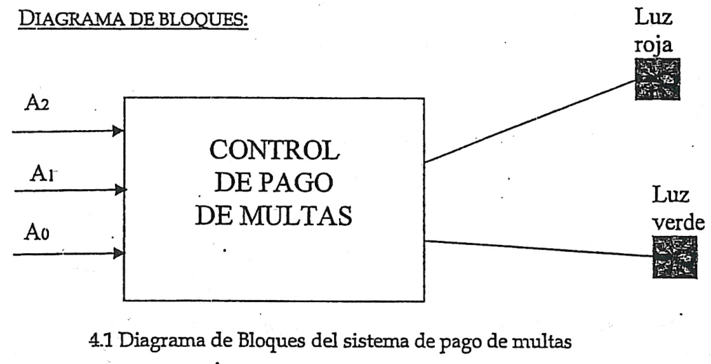


#### Crear el proyecto

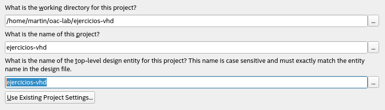

Para la Cyclone IV

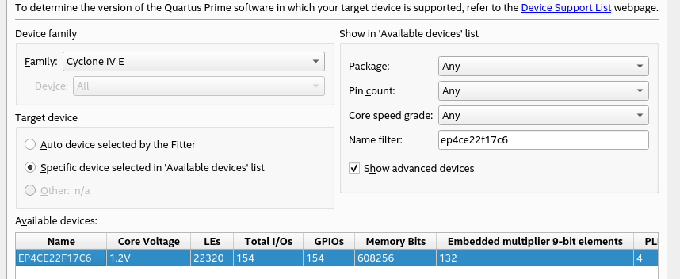

Se crea un nuevo archivo **control_pago_multas.vhd**


#### Implementación en VHDL

```vhdl
library ieee;
use ieee.std_logic_1164.all;
use ieee.std_logic_unsigned.all;

entity pago is
	port(
		a: in std_logic_vector( 2 downto 0 );
		luz_roja: out std_logic;
		luz_verde: out std_logic
	);
end pago;

architecture behavioral of pago is
begin
	process ( a )
	begin
		case a is
			when "000" =>
				luz_roja <= '0';
				luz_verde <= '1';
			when "001" => 
				luz_roja <= '0';
				luz_verde <= '1';
			when "010" =>
				luz_roja <= '0';
				luz_verde <= '1';
			when "011" => 
				luz_roja <= '0';
				luz_verde <= '1';
			when "100" => 
				luz_roja <= '0';
				luz_verde <= '1';
			when "101" => 
				luz_roja <= '1';
				luz_verde <= '0';
			when "110" =>
				luz_roja <= '1';
				luz_verde <= '0';
			when "111" => 
				luz_roja <= '1';
				luz_verde <= '0';
			when  others =>
				luz_roja <= '0';
				luz_verde <= '0';
		end  case;
	end process;
end behavioral;
```

#### Compilación

El  archivo **pago.vhd** se define como top level entity y se inicia la compilación. dando como resultado el siguiente RTL.

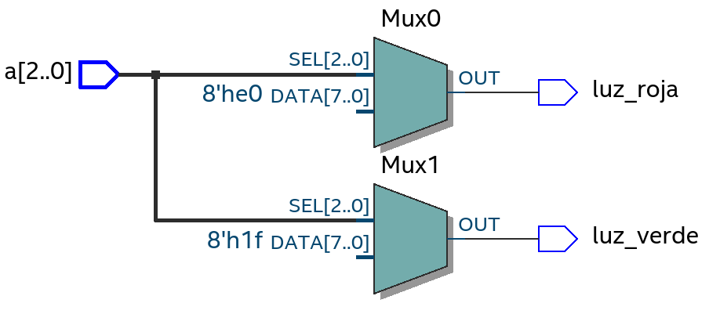

### Simulación en Questa

Se agregan las variables de interés y se configuran las señales $A_1 A_2 A_3$ para generar las posibles combinaciones.

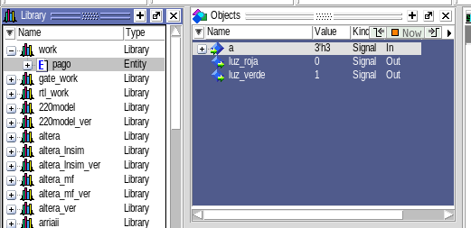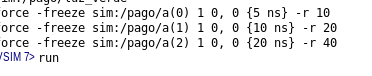


Se obtiene esta forma de onda.

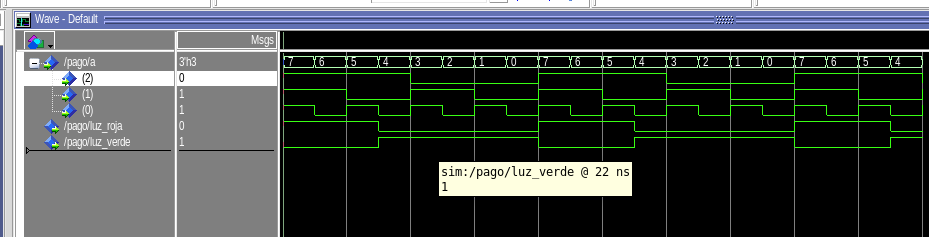

podemos ver que en general se paga la multa, solo cuando $A_2$ y $A_1$ dicen que debe pagar.

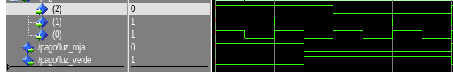

### 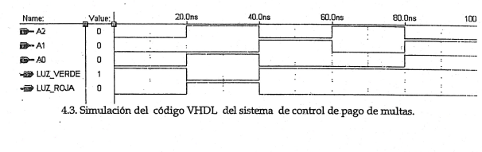

### Parte 2. Diseño de un bus MUX

#### Objetivo:

Que le alumno aprenda el manejo del flujo de datos en un multiplexor.

#### Especificaciones.

Diseñar y construir un selector cuya salida sea un vector de 7 bits, de forma tal que cuando las 4 combinaciones distintas que se tienen en el valor de selección de entrada $A(A_1,A_0)$.

| Combinación | Letra |
| ----------- | ----- |
| 00          | H     |
| 01          | O     |
| 10          | L     |
| 11          | A     |

Se utiliza lógica negada para la asignación binaria de los vectores de salida.

En la figura 8.1 se observa el diagrama de bloques requerido, en la figura 8.2 el código VHDL y la simulación se muestra en la figura 8.3

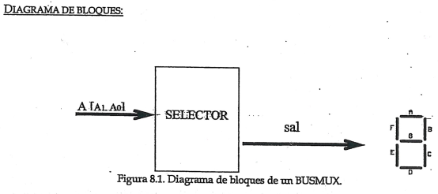

#### Imprelemtación en VHDL

Se agrega el archivo **busmux.vhd**

```vhdl
library ieee;
use ieee.std_logic_1164.all;
use ieee.std_logic_unsigned.all;

entity busmux is
	port(
		a: in std_logic_vector ( 1 downto 0 );
		sal: out std_logic_vector ( 6 downto 0 )
	);
end busmux;

architecture behavioral of busmux is
begin
	process (a)
	begin 
		case a is
			when "00" => sal <= "0001001";
			when "01" => sal <= "1000000";
			when "10" => sal <= "1000111";
			when "11" => sal <= "0001000";
			when others => sal <= "0000000";
		end case;
	end process;
end behavioral;
```

#### Simulación

Se seleccionan las variables de interés y se da un radix binario a **sal** para verificar las combinaciones.

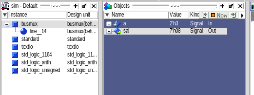

Obteniendo la siguiente salida.

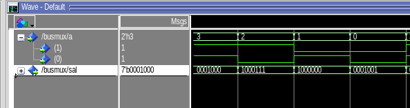

Donde vemos que son las salidas esperadas, por ejemplo **0001001** para **00**

### Conclusiones

Con ejercicios de VHDL en los que se abordan circuitos combinatorios de distintos tipos, y se explora la forma en que se simulan podemos darnos una idea bastante clara de como se comportarán estos en una implementación en el mundo real, por ejemplo en una tarjeta de desarrollo como la Ciclone IV o la DE10-lite.

Con lo que se vuelve más clara la comprensión del funcionamiento de este tipo de circuitos. A la vez que nos familiarizamos con las herramientas de desarrollo y simulación.
